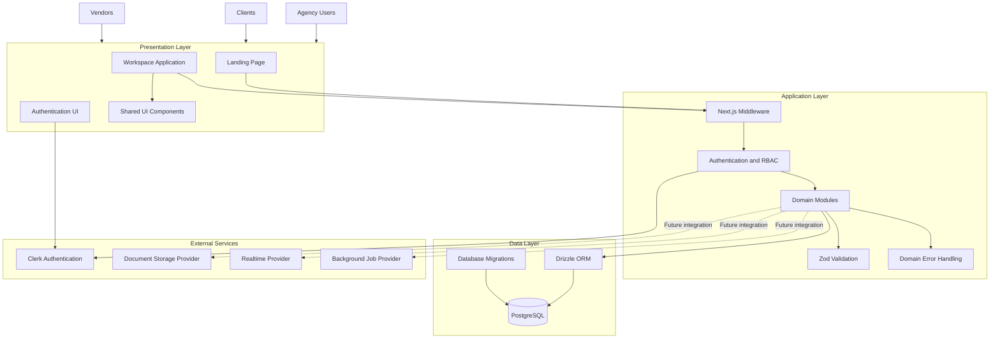
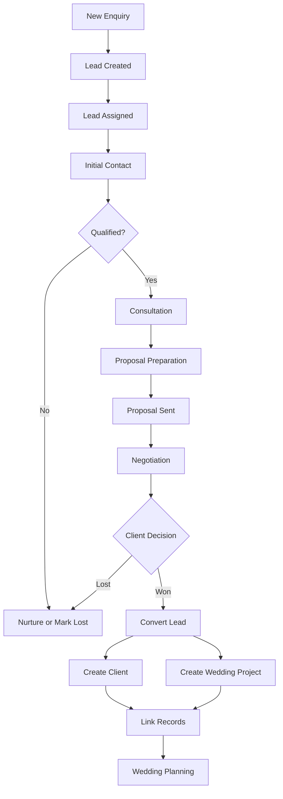
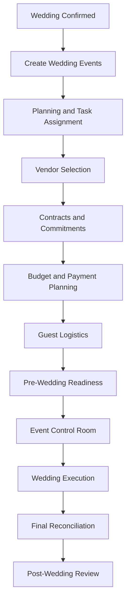
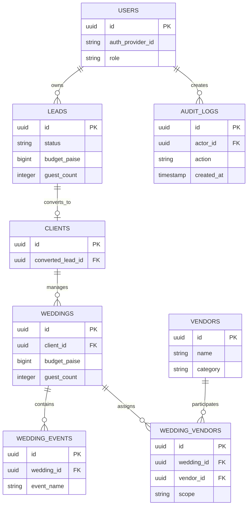
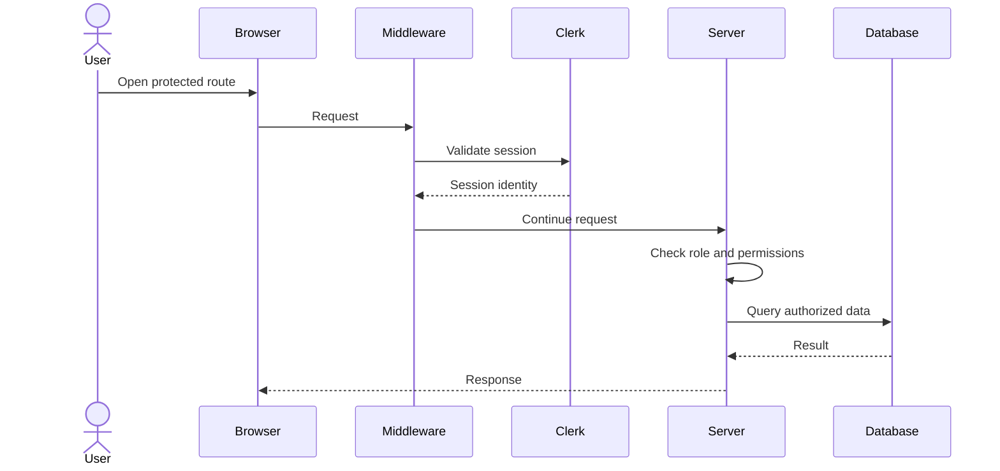
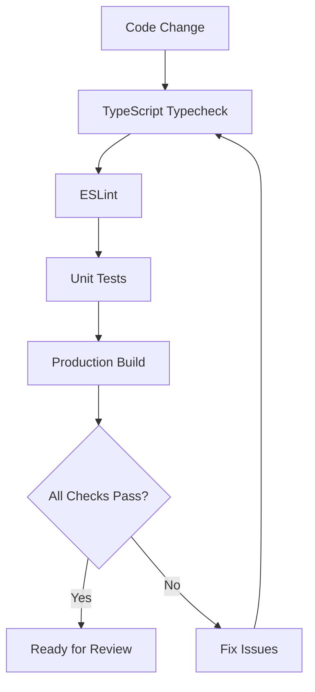

# Gathbandhan

### The Operating System for Luxury Wedding Planning

<p align="center">
  <strong>Plan beautifully. Execute flawlessly. Manage every detail.</strong>
</p>

<p align="center">
  A unified wedding planning and management platform for luxury wedding agencies in India.
</p>

---

## Table of Contents

- [Overview](#-overview)
- [The Problem](#-the-problem)
- [Vision and Goals](#-vision-and-goals)
- [Core Capabilities](#-core-capabilities)
- [Product Modules](#-product-modules)
- [System Architecture](#-system-architecture)
- [Business Workflows](#-business-workflows)
- [Database Architecture](#-database-architecture)
- [Authentication and Authorization](#-authentication-and-authorization)
- [Technology Stack](#-technology-stack)
- [Project Structure](#-project-structure)
- [Getting Started](#-getting-started)
- [Environment Variables](#-environment-variables)
- [Database Setup](#-database-setup)
- [Development Commands](#-development-commands)
- [Testing and Quality Assurance](#-testing-and-quality-assurance)
- [Security and Data Integrity](#-security-and-data-integrity)
- [Roadmap](#-roadmap)
- [Development Principles](#-development-principles)
- [Contributing](#-contributing)
- [License](#-license)

---

## 📌 Overview

**Gathbandhan OS** is a modern, full-stack wedding planning management platform designed for luxury wedding planning agencies operating in India.

The platform brings the entire wedding lifecycle into one centralized workspace—from the first client enquiry to wedding execution, vendor coordination, financial settlement, and post-wedding business analytics.

It is designed for agencies managing large destination weddings, multi-day celebrations, numerous vendors, complex budgets, and high expectations from clients.

Gathbandhan aims to replace fragmented workflows involving WhatsApp conversations, spreadsheets, PDFs, paper checklists, and disconnected financial records with a unified operational system.

### Product Identity

| Attribute | Description |
|---|---|
| Product Name | Gathbandhan OS |
| Product Category | Wedding Planning Management System |
| Target Users | Luxury wedding planning agencies |
| Primary Market | India |
| Typical Wedding Size | 400+ guests |
| Typical Vendor Network | 18+ specialized vendors per wedding |
| Wedding Format | Multi-day destination weddings |
| Currency | INR |
| Monetary Storage | Integer paise |
| Primary Timezone | Asia/Kolkata (IST) |

> Gathbandhan is designed around the operational complexity of luxury weddings—not simply as a wedding checklist application.

---

## 🎯 The Problem

Luxury wedding planning involves coordinating multiple interconnected business and operational processes.

A typical wedding may involve:

- Multiple family members and decision-makers.
- Several days of wedding events.
- Dozens of vendors and service providers.
- Large budgets and staged payments.
- Detailed guest accommodation and transportation.
- Constant timeline changes.
- High expectations for real-time coordination.

When these processes are managed through disconnected tools, several problems arise.

| Problem | Business Impact |
|---|---|
| Enquiries scattered across WhatsApp, calls, and Instagram | Leads are missed or forgotten |
| Vendor quotations stored as PDFs | Manual comparisons are slow and error-prone |
| Paper-based checklists | Tasks are difficult to track and delegate |
| Vendor dependencies are not visible | Delays cascade into other wedding activities |
| Payments are tracked manually | Duplicate payments and financial leakage |
| Wedding budgets are maintained separately | Actual profitability becomes difficult to determine |
| Guest information is fragmented | RSVP and logistics coordination becomes inefficient |
| Founder reports are prepared manually | Business decisions are delayed |

Gathbandhan provides a centralized system of record for these workflows.

---

## 🚀 Vision and Goals

### Vision

Build the most reliable operational platform for luxury wedding planning agencies in India.

### Goals

1. Centralize client, lead, vendor, wedding, and financial information.
2. Make every wedding operationally trackable.
3. Reduce manual coordination and repetitive data entry.
4. Improve vendor selection through structured quotation comparison.
5. Protect financial integrity through transaction-safe workflows.
6. Provide real-time visibility into wedding execution.
7. Give agency founders actionable business intelligence.
8. Deliver an elegant, premium user experience.

### Non-Goals

Gathbandhan is not intended to be:

- A generic task management application.
- A public wedding inspiration marketplace.
- A standalone accounting replacement.
- A simple vendor directory.
- A consumer-only wedding checklist application.

The product is designed primarily for the internal operations of professional wedding planning agencies, with client and vendor experiences where appropriate.

---

## ✨ Core Capabilities

The long-term product is organized around the following capabilities.

### 1. CRM and Lead Management

Capture, qualify, assign, and convert wedding enquiries.

Planned capabilities include:

- Lead capture from multiple sources.
- Lead ownership and assignment.
- Sales pipeline management.
- Follow-up scheduling.
- Client consultation tracking.
- Lead activity history.
- Lead-to-wedding conversion.
- Conversion analytics.

### 2. Client Portal

Provide clients with a centralized place to access wedding information.

Planned capabilities include:

- Wedding overview.
- Event itinerary.
- Agreements and documents.
- Approvals.
- Selected planning updates.
- Guest-related information.

### 3. Vendor Management

Maintain a structured vendor directory and vendor relationship history.

Planned capabilities include:

- Vendor profiles.
- Categories and specialties.
- Contact information.
- Service areas.
- Vendor availability.
- Wedding assignments.
- Contract and scope information.
- Vendor performance records.

### 4. Smart Vendor Quotations

Make vendor quotation evaluation more structured.

Planned capabilities include:

- PDF quotation ingestion.
- Quote normalization.
- Cost comparison.
- Guest-count sensitivity.
- Inclusion and exclusion comparison.
- Landed-cost calculations.
- Weighted vendor scoring.
- Quote version history.

### 5. Wedding Planning

Manage wedding projects and their interconnected tasks.

Planned capabilities include:

- Multi-day event planning.
- Task assignment.
- Task dependencies.
- Planning milestones.
- Deadline tracking.
- Checklist templates.
- Progress monitoring.

### 6. Event Control Room

Provide an operational view of wedding-day execution.

Planned capabilities include:

- Live event timelines.
- Vendor check-in.
- Arrival monitoring.
- Delay alerts.
- Incident logging.
- Timeline adjustments.
- Operational status tracking.

### 7. Financial Integrity

Track wedding budgets, commitments, payments, and profitability.

Planned capabilities include:

- Budget management.
- Vendor payment milestones.
- Payment status tracking.
- Duplicate payment prevention.
- Additional expense tracking.
- Actual versus planned cost.
- Profitability monitoring.
- Financial audit history.

### 8. Guest Logistics

Manage guest-related wedding operations.

Planned capabilities include:

- Guest records.
- RSVP tracking.
- Household grouping.
- Accommodation requirements.
- Transportation coordination.
- Event attendance.
- Guest communication status.

### 9. Founder Analytics

Provide business-level visibility.

Planned capabilities include:

- Lead conversion.
- Wedding pipeline.
- Revenue and cost summaries.
- Profitability.
- Vendor performance.
- Season-level reporting.
- Operational risk indicators.

> **Implementation status:** Phase 0 and Phase 1 establish the foundation. The modules above represent the product direction; their implementation status is tracked in `docs/ROADMAP.md`.

---

## 🧩 Product Modules

The application is organized into the following workspace modules.

| Route | Module | Purpose |
|---|---|---|
| `/dashboard` | Dashboard | Agency overview and operational KPIs |
| `/leads` | CRM | Lead and client pipeline |
| `/weddings` | Weddings | Active and planned wedding projects |
| `/planning` | Planning | Tasks, checklists, and dependencies |
| `/vendors` | Vendors | Vendor directory and assignments |
| `/quotations` | Quotations | Vendor quotation comparison |
| `/control-room` | Event Control Room | Wedding-day operations |
| `/finance` | Finance | Budgets, payments, and settlements |
| `/guests` | Guests | RSVPs and guest logistics |
| `/analytics` | Analytics | Founder and season-level insights |
| `/settings` | Settings | Roles and system configuration |

The routes are established in the Phase 1 application shell. Each module is implemented incrementally according to the roadmap.

---

## 🏗 System Architecture

Gathbandhan follows a modular full-stack architecture built around Next.js, PostgreSQL, and Drizzle ORM.

### High-Level Architecture



### Architectural Principles

- Modular domain-oriented code organization.
- Server-side authorization.
- Shared validation schemas.
- Typed domain errors.
- Standardized API responses.
- Database transactions for multi-record mutations.
- Exact integer representation for money.
- Append-only audit history for important mutations.
- Incremental implementation by roadmap phase.

---

## 🔄 Business Workflows

### Lead-to-Wedding Lifecycle



### Wedding Execution Lifecycle



This represents the intended product workflow. Individual stages are delivered through the roadmap.

---

## 🗄 Database Architecture

The database uses PostgreSQL with Drizzle ORM.

The Phase 1 foundation includes normalized schemas for:

- Users.
- Leads.
- Clients.
- Weddings.
- Wedding events.
- Vendors.
- Wedding-vendor assignments.
- Audit logs.

### Entity Relationship Diagram



> The diagram is a conceptual representation of the current foundation. Consult `src/lib/db/schema/` and the generated migrations for the authoritative schema.

### Data Modeling Principles

- Use UUIDs for entity identifiers where defined by the schema.
- Use foreign keys for relational integrity.
- Use explicit join entities for wedding-vendor relationships.
- Preserve lead history after conversion.
- Use soft deletion where supported.
- Keep audit records append-only.
- Represent monetary values as integer paise.

---

## 🔐 Authentication and Authorization

Gathbandhan uses Clerk for authentication and a server-side role-based access control system.

### Supported Roles

| Role | Intended Responsibility |
|---|---|
| `FOUNDER_ADMIN` | Agency-wide administration and oversight |
| `PLANNER` | Wedding planning and client coordination |
| `FINANCE` | Budgets, payments, and financial operations |
| `ONSITE_COORDINATOR` | Wedding-day execution |
| `VENDOR` | Authorized vendor-specific access |
| `CLIENT` | Authorized client portal access |

### Authorization Flow



### Security Principles

- Authentication does not automatically imply authorization.
- Every sensitive mutation must be checked server-side.
- Access to wedding records must respect wedding-level permissions.
- Vendor and client access must be scoped appropriately.
- Public vendor check-in flows must use their intended token-based access model.
- Sensitive information must not be exposed in client-side code.
- Secrets must be stored in environment variables.

The role definitions and permission matrix are maintained in:

```text
src/lib/auth/roles.ts
src/lib/auth/index.ts
```

---

## 💻 Technology Stack

The project uses a fixed, documented technology baseline.

| Technology | Version / Baseline | Purpose |
|---|---|---|
| Node.js | 22.x | Runtime |
| pnpm | 10.17.1 | Package management |
| Next.js | 15.5.6 | Full-stack application framework |
| React | 19.1.1 | UI rendering |
| TypeScript | 5.9.2 | Type safety |
| Tailwind CSS | 3.4.17 | Styling |
| Drizzle ORM | 0.44.5 | Database access |
| PostgreSQL | 16.x | Relational database |
| Zod | 4.1.12 | Runtime validation |
| Clerk | 6.32.0 | Authentication |
| React Hook Form | 7.62.0 | Form management |
| Recharts | 2.15.4 | Data visualization |
| TanStack Table | 8.21.3 | Data tables |
| Vitest | 3.2.4 | Unit testing |
| Playwright | 1.55.0 | End-to-end testing |
| Lucide React | 0.545.0 | Icons |
| date-fns | 4.1.0 | Date utilities |

The actual installed versions in `package.json` and `pnpm-lock.yaml` are authoritative.

### Design System

The visual system uses a premium wedding-inspired palette.

| Token | Value | Usage |
|---|---|---|
| Warm Ivory | `#FDFBF0` | Primary surface |
| Charcoal | `#2A2A2A` | Navigation and typography |
| Muted Gold | `#C5A855` | Accent color |

The application uses Inter and Playfair Display typography, with semantic status tokens for operational states.

---

## 📁 Project Structure

The following is a high-level representation of the application structure.

```text
gathbandhan-os/
├── docs/
│   ├── architecture/
│   │   ├── TECH_STACK.md
│   │   ├── ARCHITECTURE.md
│   │   ├── DATA_MODEL.md
│   │   ├── API_CONTRACTS.md
│   │   ├── DECISIONS.md
│   │   └── SECURITY_AND_TESTING.md
│   ├── prd/
│   └── ROADMAP.md
│
├── drizzle/
│   ├── 0000_dashing_ozymandias.sql
│   └── 0001_milky_kree.sql
│
├── public/
│
├── src/
│   ├── app/
│   │   ├── (auth)/
│   │   │   ├── sign-in/
│   │   │   └── sign-up/
│   │   ├── (workspace)/
│   │   │   ├── dashboard/
│   │   │   ├── leads/
│   │   │   ├── weddings/
│   │   │   ├── planning/
│   │   │   ├── vendors/
│   │   │   ├── quotations/
│   │   │   ├── control-room/
│   │   │   ├── finance/
│   │   │   ├── guests/
│   │   │   ├── analytics/
│   │   │   └── settings/
│   │   ├── globals.css
│   │   ├── layout.tsx
│   │   └── page.tsx
│   │
│   ├── components/
│   │   ├── ui/
│   │   └── shared/
│   │
│   ├── lib/
│   │   ├── auth/
│   │   ├── dates/
│   │   ├── db/
│   │   │   ├── schema/
│   │   │   ├── index.ts
│   │   │   └── seed.ts
│   │   ├── errors/
│   │   ├── money/
│   │   ├── validation/
│   │   └── utils.ts
│   │
│   ├── middleware.ts
│   └── tests/
│
├── .env.example
├── .nvmrc
├── drizzle.config.ts
├── eslint.config.mjs
├── next.config.ts
├── package.json
├── pnpm-lock.yaml
├── tailwind.config.ts
├── tsconfig.json
└── vitest.config.ts
```

> This tree reflects the documented Phase 1 structure. Use the actual repository tree if files have since been added or renamed.

---

## ⚙️ Getting Started

### Prerequisites

Install the following:

- Node.js 22.x.
- pnpm 10.17.1.
- PostgreSQL 16.x or a compatible hosted PostgreSQL service.
- A Clerk application for live authentication.

The project includes an `.nvmrc` file to help maintain the expected Node.js runtime.

### 1. Clone the Repository

```bash
git clone <your-repository-url>
cd gathbandhan-os
```

### 2. Use the Expected Node.js Version

```bash
nvm install
nvm use
```

Verify the runtime:

```bash
node --version
pnpm --version
```

### 3. Install Dependencies

```bash
corepack enable
pnpm install --frozen-lockfile
```

### 4. Configure Environment Variables

```bash
cp .env.example .env.local
```

Fill in the required values.

### 5. Run the Development Server

```bash
pnpm dev
```

Open:

```text
http://localhost:3000
```

---

## 🔑 Environment Variables

The application uses environment variables for database access and authentication.

An example configuration is maintained in `.env.example`.

| Variable | Purpose |
|---|---|
| `DATABASE_URL` | PostgreSQL connection string |
| `NEXT_PUBLIC_CLERK_PUBLISHABLE_KEY` | Clerk publishable key |
| `CLERK_SECRET_KEY` | Clerk secret key |

Additional variables may be introduced as modules and integrations are implemented.

### Environment Safety

- Never commit `.env.local`.
- Never expose server secrets through `NEXT_PUBLIC_` variables.
- Use separate credentials for development, testing, and production.
- Do not use production credentials in local seed scripts.
- Keep `.env.example` free of real credentials.

---

## 🗃 Database Setup

Gathbandhan uses Drizzle ORM for schema management and migrations.

### Generate Migrations

```bash
pnpm db:generate
```

### Apply Database Changes

Use the migration command defined in `package.json`.

For environments where the project uses Drizzle Kit push:

```bash
pnpm db:push
```

Review generated SQL and migration history before applying schema changes to a shared or production database.

### Seed Development Data

```bash
pnpm db:seed
```

The deterministic seed script establishes demonstration records for the foundational modules.

The documented Phase 1 dataset includes:

- Users across agency roles.
- Four pipeline leads.
- One converted anchor client.
- A sample Sharma Royal Wedding.
- A ₹2 crore wedding budget.
- 400 guests.
- Four multi-day wedding events.
- Eighteen specialized vendors.
- Wedding-vendor assignments.
- Initial audit entries.

Seed data is intended for development and demonstration. Do not execute it against production without reviewing the script.

---

## 🛠 Development Commands

The following commands are used by the project.

| Command | Purpose |
|---|---|
| `pnpm dev` | Start local development server |
| `pnpm build` | Create production build |
| `pnpm start` | Start production server |
| `pnpm typecheck` | Run TypeScript checks |
| `pnpm lint` | Run linting |
| `pnpm test` | Run unit tests |
| `pnpm db:generate` | Generate Drizzle migrations |
| `pnpm db:push` | Apply schema changes using the configured Drizzle workflow |
| `pnpm db:seed` | Seed development data |

Check `package.json` for the exact scripts configured in the repository.

---

## 🧪 Testing and Quality Assurance

Gathbandhan uses automated checks to maintain implementation quality.

### Quality Gates



### Phase 1 Verification

The Phase 0 and Phase 1 completion report recorded the following results:

| Quality Gate | Result |
|---|---|
| Unit Tests | 26 passed |
| Type Checking | Passed |
| Linting | Passed |
| Production Build | Passed |
| Static
