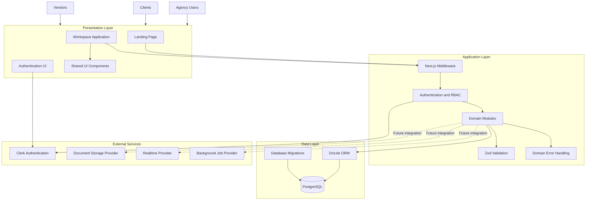
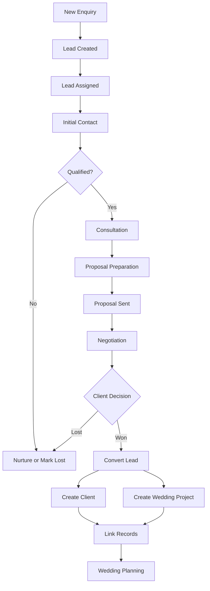
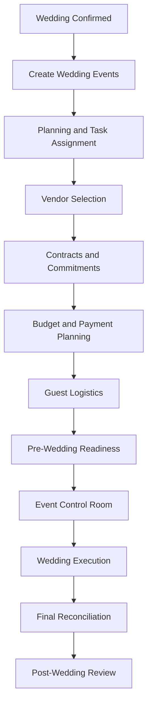
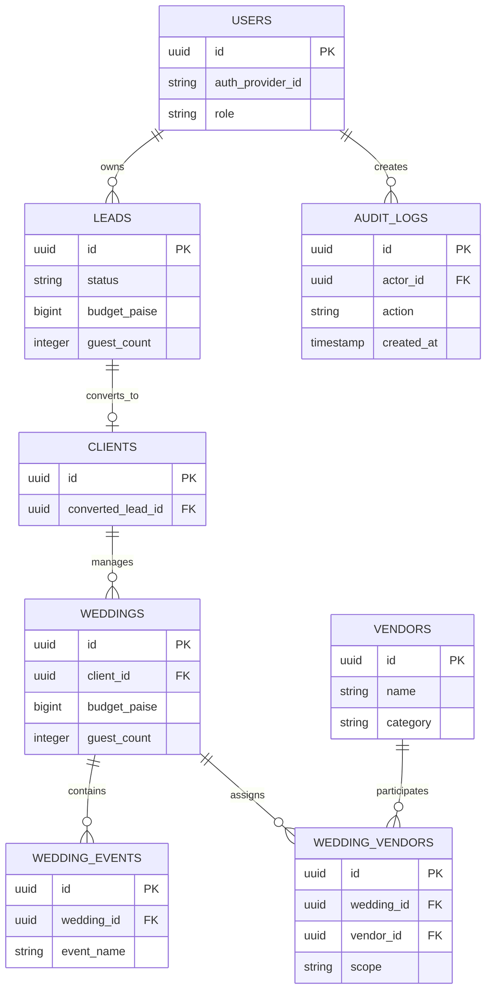
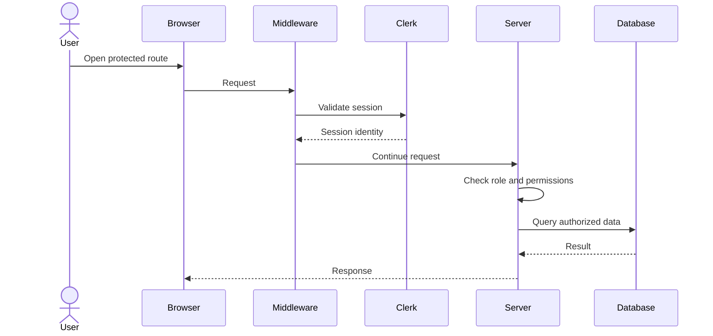
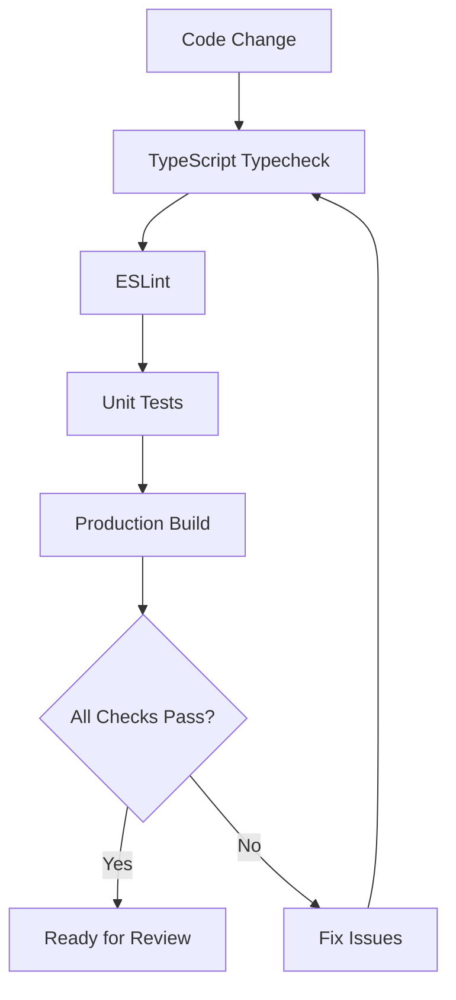

# Gathbandhan

### The Operating System for Luxury Wedding Planning

**Plan beautifully. Execute flawlessly. Manage every detail.**

A unified planning and operations platform for luxury wedding agencies in India.


---

## Table of Contents

- [Overview](#overview)
- [The Problem](#the-problem)
- [Vision and Goals](#vision-and-goals)
- [Core Capabilities](#core-capabilities)
- [Product Modules](#product-modules)
- [System Architecture](#system-architecture)
- [Business Workflows](#business-workflows)
- [Database Architecture](#database-architecture)
- [Authentication and Authorization](#authentication-and-authorization)
- [Technology Stack](#technology-stack)
- [Project Structure](#project-structure)
- [Getting Started](#getting-started)
- [Environment Variables](#environment-variables)
- [Database Setup](#database-setup)
- [Development Commands](#development-commands)
- [Testing and Quality Assurance](#testing-and-quality-assurance)
- [Security and Data Integrity](#security-and-data-integrity)
- [Roadmap](#roadmap)
- [Development Principles](#development-principles)
- [Contributing](#contributing)
- [License](#license)

---

## Overview

**Gathbandhan OS** is a full-stack wedding planning management platform built for luxury wedding agencies operating in India. The name comes from *Gathbandhan*, the ritual in which the couple's garments are tied together. The product does the same for an agency's operations: it ties together clients, vendors, tasks, schedules, guests, and money in one system of record.

The platform covers the entire wedding lifecycle, from the first client enquiry through planning, vendor coordination, wedding-day execution, financial settlement, and post-wedding business analytics. It replaces fragmented workflows built on WhatsApp conversations, spreadsheets, PDFs, paper checklists, and disconnected financial records.

### Product Identity

| Attribute | Description |
|---|---|
| Product name | Gathbandhan OS |
| Category | Wedding Planning Management System |
| Target users | Couples planning weddings, wedding vendors, and wedding planning agencies |
| Primary market | India |
| Typical wedding size | 400+ guests |
| Typical vendor network | 18+ specialized vendors per wedding |
| Wedding format | Multi-day destination weddings |
| Currency | INR |
| Monetary storage | Integer paise |
| Primary timezone | Asia/Kolkata (IST) |

> Gathbandhan is designed around the operational complexity of luxury weddings. It is not a wedding checklist application.

---

## The Problem

A single luxury wedding involves several interconnected business and operational processes:

- Multiple family members and decision-makers
- Several days of events
- Dozens of vendors and service providers
- Large budgets paid in stages
- Guest accommodation and transportation
- Constant timeline changes
- High expectations for real-time coordination

When these are managed through disconnected tools, the consequences are predictable.

| Problem | Business Impact |
|---|---|
| Enquiries scattered across WhatsApp, calls, and Instagram | Leads are missed or forgotten |
| Vendor quotations stored as PDFs | Manual comparison is slow and error-prone |
| Paper-based checklists | Tasks are hard to track and delegate |
| Vendor dependencies are not visible | Delays cascade into other wedding activities |
| Manual payment tracking | Duplicate payments and financial leakage |
| Budgets maintained separately | Actual profitability is hard to determine |
| Fragmented guest information | RSVP and logistics coordination is inefficient |
| Manually prepared founder reports | Business decisions are delayed |

Gathbandhan provides a centralized system of record for all of these workflows.

---

## Vision and Goals

### Vision

Build the most reliable operational platform for luxury wedding planning agencies in India.

### Goals

1. Centralize client, lead, vendor, wedding, and financial information.
2. Make every wedding operationally trackable.
3. Reduce manual coordination and repetitive data entry.
4. Improve vendor selection through structured quotation comparison.
5. Protect financial integrity through transaction-safe workflows.
6. Provide real-time visibility into wedding execution.
7. Give agency founders actionable business intelligence.
8. Deliver an elegant, premium user experience.

### Non-Goals

Gathbandhan is not intended to be:

- A generic task management application
- A public wedding inspiration marketplace
- A standalone accounting replacement
- A simple vendor directory
- A consumer-only wedding checklist application

The product serves the internal operations of professional wedding planning agencies, with client and vendor experiences where appropriate.

---

## Core Capabilities

The long-term product is organized around nine capabilities.

### 1. CRM and Lead Management

Capture, qualify, assign, and convert wedding enquiries.

- Lead capture from multiple sources
- Lead ownership and assignment
- Sales pipeline management
- Follow-up scheduling
- Client consultation tracking
- Lead activity history
- Lead-to-wedding conversion
- Conversion analytics

### 2. Client Portal

Give clients a central place to access wedding information.

- Wedding overview
- Event itinerary
- Agreements and documents
- Approvals
- Selected planning updates
- Guest-related information

### 3. Vendor Management

Maintain a structured vendor directory and relationship history.

- Vendor profiles
- Categories and specialties
- Contact information and service areas
- Vendor availability
- Wedding assignments
- Contract and scope information
- Vendor performance records

### 4. Smart Vendor Quotations

Make quotation evaluation structured and comparable.

- PDF quotation ingestion
- Quote normalization
- Cost comparison and landed-cost calculation
- Guest-count sensitivity
- Inclusion and exclusion comparison
- Weighted vendor scoring
- Quote version history

### 5. Wedding Planning

Manage wedding projects and their interconnected tasks.

- Multi-day event planning
- Task assignment and dependencies
- Planning milestones and deadline tracking
- Checklist templates
- Progress monitoring

### 6. Event Control Room

Provide an operational view of wedding-day execution.

- Live event timelines
- Vendor check-in and arrival monitoring
- Delay alerts
- Incident logging
- Timeline adjustments
- Operational status tracking

### 7. Financial Integrity

Track budgets, commitments, payments, and profitability.

- Budget management
- Vendor payment milestones and status tracking
- Duplicate payment prevention
- Additional expense tracking
- Actual versus planned cost
- Profitability monitoring
- Financial audit history

### 8. Guest Logistics

Manage guest-related wedding operations.

- Guest records and household grouping
- RSVP tracking
- Accommodation requirements
- Transportation coordination
- Event attendance
- Guest communication status

### 9. Founder Analytics

Provide business-level visibility.

- Lead conversion
- Wedding pipeline
- Revenue and cost summaries
- Profitability
- Vendor performance
- Season-level reporting
- Operational risk indicators

> **Implementation status:** Phase 0 and Phase 1 establish the foundation. The capabilities above describe the product direction. Delivery status is tracked in [`docs/ROADMAP.md`](docs/ROADMAP.md).

---

## Product Modules

The workspace is organized into the following modules.

| Route | Module | Purpose |
|---|---|---|
| `/dashboard` | Dashboard | Agency overview and operational KPIs |
| `/leads` | CRM | Lead and client pipeline |
| `/weddings` | Weddings | Active and planned wedding projects |
| `/planning` | Planning | Tasks, checklists, and dependencies |
| `/vendors` | Vendors | Vendor directory and assignments |
| `/quotations` | Quotations | Vendor quotation comparison |
| `/control-room` | Event Control Room | Wedding-day operations |
| `/finance` | Finance | Budgets, payments, and settlements |
| `/guests` | Guests | RSVPs and guest logistics |
| `/analytics` | Analytics | Founder and season-level insights |
| `/settings` | Settings | Roles and system configuration |

The routes are established in the Phase 1 application shell. Each module is implemented incrementally according to the roadmap.

---

## System Architecture

Gathbandhan follows a modular full-stack architecture built on Next.js, PostgreSQL, and Drizzle ORM.



### Architectural Principles

- Modular, domain-oriented code organization
- Server-side authorization
- Shared validation schemas
- Typed domain errors
- Standardized API responses
- Database transactions for multi-record mutations
- Exact integer representation for money
- Append-only audit history for important mutations
- Incremental delivery by roadmap phase

---

## Business Workflows

### Lead-to-Wedding Lifecycle



### Wedding Execution Lifecycle



These diagrams represent the intended product workflow. Individual stages are delivered through the roadmap.

---

## Database Architecture

The database uses PostgreSQL with Drizzle ORM. The Phase 1 foundation includes normalized schemas for users, leads, clients, weddings, wedding events, vendors, wedding-vendor assignments, and audit logs.



> The diagram is a conceptual view of the current foundation. The authoritative schema lives in `src/lib/db/schema/` and the generated migrations in `drizzle/`.

### Data Modeling Principles

- UUID identifiers where defined by the schema
- Foreign keys for relational integrity
- Explicit join entities for wedding-vendor relationships
- Lead history preserved after conversion
- Soft deletion where supported
- Append-only audit records
- Monetary values stored as integer paise

---

## Authentication and Authorization

Gathbandhan uses **Clerk** for authentication and a server-side role-based access control (RBAC) system for authorization.

### Supported Roles

| Role | Responsibility |
|---|---|
| `FOUNDER_ADMIN` | Agency-wide administration and oversight |
| `PLANNER` | Wedding planning and client coordination |
| `FINANCE` | Budgets, payments, and financial operations |
| `ONSITE_COORDINATOR` | Wedding-day execution |
| `VENDOR` | Authorized, vendor-specific access |
| `CLIENT` | Authorized client portal access |

### Authorization Flow



### Security Principles

- Authentication does not imply authorization.
- Every sensitive mutation is checked server-side.
- Access to wedding records respects wedding-level permissions.
- Vendor and client access is scoped to the records they are authorized to see.
- Public vendor check-in flows use a token-based access model.
- Sensitive information is never exposed in client-side code.
- Secrets are stored in environment variables.

The role definitions and permission matrix are maintained in:

```text
src/lib/auth/roles.ts
src/lib/auth/index.ts
```

---

## Technology Stack

The project uses a fixed, documented technology baseline.

| Technology | Version / Baseline | Purpose |
|---|---|---|
| Node.js | 22.x | Runtime |
| pnpm | 10.17.1 | Package management |
| Next.js | 15.5.6 | Full-stack application framework |
| React | 19.1.1 | UI rendering |
| TypeScript | 5.9.2 | Type safety |
| Tailwind CSS | 3.4.17 | Styling |
| Drizzle ORM | 0.44.5 | Database access |
| PostgreSQL | 16.x | Relational database |
| Zod | 4.1.12 | Runtime validation |
| Clerk | 6.32.0 | Authentication |
| React Hook Form | 7.62.0 | Form management |
| Recharts | 2.15.4 | Data visualization |
| TanStack Table | 8.21.3 | Data tables |
| Vitest | 3.2.4 | Unit testing |
| Playwright | 1.55.0 | End-to-end testing |
| Lucide React | 0.545.0 | Icons |
| date-fns | 4.1.0 | Date utilities |

> The installed versions in `package.json` and `pnpm-lock.yaml` are authoritative.

### Design System

The visual identity uses a premium, wedding-inspired palette with Inter and Playfair Display typography, plus semantic status tokens for operational states.

| Token | Value | Usage |
|---|---|---|
| Warm Ivory | `#FDFBF0` | Primary surface |
| Charcoal | `#2A2A2A` | Navigation and typography |
| Muted Gold | `#C5A855` | Accent color |

---

## Project Structure

```text
gathbandhan-os/
├── docs/
│   ├── architecture/
│   │   ├── TECH_STACK.md
│   │   ├── ARCHITECTURE.md
│   │   ├── DATA_MODEL.md
│   │   ├── API_CONTRACTS.md
│   │   ├── DECISIONS.md
│   │   └── SECURITY_AND_TESTING.md
│   ├── prd/
│   └── ROADMAP.md
│
├── drizzle/                     # Generated SQL migrations
│   ├── 0000_dashing_ozymandias.sql
│   └── 0001_milky_kree.sql
│
├── public/
│
├── src/
│   ├── app/
│   │   ├── (auth)/
│   │   │   ├── sign-in/
│   │   │   └── sign-up/
│   │   ├── (workspace)/
│   │   │   ├── dashboard/
│   │   │   ├── leads/
│   │   │   ├── weddings/
│   │   │   ├── planning/
│   │   │   ├── vendors/
│   │   │   ├── quotations/
│   │   │   ├── control-room/
│   │   │   ├── finance/
│   │   │   ├── guests/
│   │   │   ├── analytics/
│   │   │   └── settings/
│   │   ├── globals.css
│   │   ├── layout.tsx
│   │   └── page.tsx
│   │
│   ├── components/
│   │   ├── ui/
│   │   └── shared/
│   │
│   ├── lib/
│   │   ├── auth/
│   │   ├── dates/
│   │   ├── db/
│   │   │   ├── schema/
│   │   │   ├── index.ts
│   │   │   └── seed.ts
│   │   ├── errors/
│   │   ├── money/
│   │   ├── validation/
│   │   └── utils.ts
│   │
│   ├── middleware.ts
│   └── tests/
│
├── .env.example
├── .nvmrc
├── drizzle.config.ts
├── eslint.config.mjs
├── next.config.ts
├── package.json
├── pnpm-lock.yaml
├── tailwind.config.ts
├── tsconfig.json
└── vitest.config.ts
```

> This tree reflects the documented Phase 1 structure. Refer to the repository for the current layout.

---

## Getting Started

### Prerequisites

- Node.js 22.x
- pnpm 10.17.1
- PostgreSQL 16.x, or a compatible hosted PostgreSQL service
- A Clerk application for authentication

The repository includes an `.nvmrc` file to pin the expected Node.js runtime.

### Installation

**1. Clone the repository**

```bash
git clone <your-repository-url>
cd gathbandhan-os
```

**2. Use the expected Node.js version**

```bash
nvm install
nvm use
node --version
```

**3. Install dependencies**

```bash
corepack enable
pnpm install --frozen-lockfile
pnpm --version
```

**4. Configure environment variables**

```bash
cp .env.example .env.local
```

Fill in the required values (see [Environment Variables](#environment-variables)).

**5. Prepare the database**

```bash
pnpm db:push
pnpm db:seed
```

**6. Start the development server**

```bash
pnpm dev
```

Open [http://localhost:3000](http://localhost:3000).

---

## Environment Variables

An example configuration is maintained in `.env.example`.

| Variable | Purpose |
|---|---|
| `DATABASE_URL` | PostgreSQL connection string |
| `NEXT_PUBLIC_CLERK_PUBLISHABLE_KEY` | Clerk publishable key |
| `CLERK_SECRET_KEY` | Clerk secret key |

Additional variables may be introduced as modules and integrations are implemented.

### Environment Safety

- Never commit `.env.local`.
- Never expose server secrets through `NEXT_PUBLIC_` variables.
- Use separate credentials for development, testing, and production.
- Do not use production credentials in local seed scripts.
- Keep `.env.example` free of real credentials.

---

## Database Setup

Gathbandhan uses Drizzle ORM for schema management and migrations.

```bash
# Generate migrations from schema changes
pnpm db:generate

# Apply schema changes using the configured Drizzle workflow
pnpm db:push

# Seed development data
pnpm db:seed
```

Review the generated SQL and migration history before applying schema changes to a shared or production database.

### Seed Data

The deterministic seed script creates demonstration records for the foundational modules:

| Seeded Data | Detail |
|---|---|
| Users | One per agency role |
| Pipeline leads | Four |
| Converted client | One anchor client |
| Sample wedding | Sharma Royal Wedding |
| Wedding budget | ₹2 crore |
| Guests | 400 |
| Wedding events | Four multi-day events |
| Vendors | Eighteen specialized vendors |
| Assignments | Wedding-vendor assignments |
| Audit entries | Initial entries |

> Seed data is for development and demonstration only. Do not run it against production without reviewing the script.

---

## Development Commands

| Command | Purpose |
|---|---|
| `pnpm dev` | Start the local development server |
| `pnpm build` | Create a production build |
| `pnpm start` | Start the production server |
| `pnpm typecheck` | Run TypeScript checks |
| `pnpm lint` | Run linting |
| `pnpm test` | Run unit tests |
| `pnpm db:generate` | Generate Drizzle migrations |
| `pnpm db:push` | Apply schema changes |
| `pnpm db:seed` | Seed development data |

Check `package.json` for the exact scripts configured in the repository.

---

## Testing and Quality Assurance

Every change passes through the same automated quality gates.



### Phase 1 Verification

The Phase 0 and Phase 1 completion report recorded the following results.

| Quality Gate | Result |
|---|---|
| Unit tests | 26 passed |
| Type checking | Passed |
| Linting | Passed |
| Production build | Passed |

Unit tests run with Vitest and end-to-end tests with Playwright.

---

## Security and Data Integrity

Financial and operational correctness are treated as product requirements.

### Data Integrity

- **Exact money.** All amounts are stored as integer paise. Floating-point arithmetic is never used for currency.
- **Transactions.** Mutations that touch multiple records run inside database transactions.
- **Append-only audit trail.** Important changes are recorded with the actor, action, and timestamp, and audit records are never updated or deleted.
- **Referential integrity.** Foreign keys and explicit join entities enforce valid relationships.
- **Soft deletion.** Where supported, records are archived rather than removed.
- **Duplicate payment prevention.** Planned as part of the Financial Integrity module, enforced at the database level rather than only in the interface.

### Application Security

- Authentication through Clerk, with authorization enforced server-side on every sensitive operation.
- Role-based access control with wedding-level scoping.
- Zod validation of all external input.
- Token-based access for public vendor check-in flows.
- Secrets confined to environment variables and never committed.

---

## Roadmap

Phase 0 and Phase 1 are complete. The remaining phases are planned and may be reordered. [`docs/ROADMAP.md`](docs/ROADMAP.md) is the source of truth for scope and status.

| Phase | Focus | Status |
|---|---|---|
| 0 | Project setup, tooling, and architecture documentation | Complete |
| 1 | Application shell, authentication, RBAC, core schema, seed data | Complete |
| 2 | CRM, lead pipeline, and agreements | Planned |
| 3 | Vendor management and smart quotations | Planned |
| 4 | Wedding planning, tasks, and dependencies | Planned |
| 5 | Financial integrity and payment milestones | Planned |
| 6 | Event control room | Planned |
| 7 | Guest logistics and client portal | Planned |
| 8 | Founder analytics and reporting | Planned |

---

## Development Principles

1. **System of record first.** Data accuracy and traceability take priority over features.
2. **Server-side trust.** The client is never trusted for authorization or business rules.
3. **Typed and validated.** TypeScript and Zod protect every boundary.
4. **Money is exact.** Integer paise, always.
5. **Auditable by default.** Important mutations leave a permanent record.
6. **Incremental delivery.** Ship in phases, each passing all quality gates.
7. **Documented decisions.** Architectural choices are recorded in `docs/architecture/DECISIONS.md`.
8. **Premium experience.** Interfaces should feel as refined as the weddings they support.

---

## Contributing

1. Create a feature branch from the main branch.
2. Follow the [Development Principles](#development-principles) and the architecture documents in `docs/architecture/`.
3. Add or update tests for any behavior change.
4. Confirm all quality gates pass before opening a pull request:

   ```bash
   pnpm typecheck && pnpm lint && pnpm test && pnpm build
   ```

5. Describe what changed and why in the pull request. Link the relevant roadmap item where applicable.

---

## License

Copyright © Gathbandhan OS contributors. All rights reserved.

*Replace this section with the project's chosen license before public release.*
